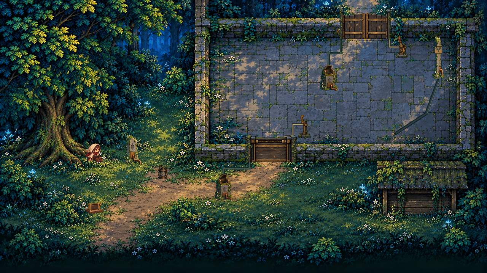

# Màn 01 — Bìa rừng quên lãng, art V4

Bộ art theo layout nhánh `level01-v4`, mốc `6dfbfc9`. Nhánh làm art: `codex/level01-v4-art`.

**42 PNG xuất ở 2×**, gồm toàn bộ P0/P1, thêm Nhinh ngồi/tỉnh dậy, tán cây và nhịp cửa A đóng. Đây là bộ art và bản ghép tham khảo; chưa được nạp vào level V4 đang chạy.

## Xem nhanh

- [Mở màn ở đúng 640×360](previews/opening-640x360.png)
- [A nhận nguồn từ S1](previews/a-powered-1280x720.png)
- [A đã gài; đèn trở lại tay Nhinh](previews/a-latched-1280x720.png)
- [Hai cửa mở](previews/both-open-1280x720.png)
- [A đóng, B mở; vẫn tiếp tục được](previews/a-closed-b-open-1280x720.png)
- [Collider chồng lên art](previews/opening-debug.png)
- [Toàn bộ sprite ở 1× và 2×](previews/sprite-contact-sheet.png)
- [Ký hiệu đặt cạnh bảng kiểm trong xưởng](previews/workshop-symbol-placement.png)

Mỗi trạng thái có ảnh 640×360, 1280×720 và bản debug. Bản ghép minh họa hình ảnh, không phải ảnh chụp gameplay. Lumo và Nhinh đứng được dùng lại từ asset hiện có.

## Danh sách

| Nhóm | File trong `sprites/` |
| --- | --- |
| Nền | `station-yard.png`, 1280×720, đã căn các biên tường và khe cửa theo layout |
| Cửa A | `door-a-closed/open.png`; `door-a-closing-1/2.png` |
| Chốt A | `latch-a-released/engaged.png` |
| Cổng B | `gate-b-closed/open.png` |
| Hãm B | `brake-b-released/engaged.png`, tay nắm và bánh cóc khác chốt A |
| Bệ S1/S2 | `socket-empty/lamp-off/lamp-on.png`, dùng chung cả hai bệ |
| Mắt nhận sáng | `eye-dormant/live.png` |
| Đèn bảo trì | `lantern-off/on.png` |
| Bia | `stele-normal/pulse.png`, có ốp đồng và ống |
| Dây bảo trì | `s1ToA-*`, `s2ToB-*`: hidden, revealed, live |
| Manh mối Pulse | `latch-tool-marks.png` |
| Tuyến nước | `water-column.png`, `dry-channel.png`, `water-route-symbol.png` |
| Ký hiệu xưởng | `workshop-water-route-plaque.png`, `workshop-route-overlay.png` |
| Bản lề | `hinge-closed/pulled/hooked.png` |
| Mầm cây | `sprout.png` |
| Mở đầu | `nhinh-sleeping/awake/rising.png`, `canopy.png` |
| Liên kết cơ khí | `mechanical-linkages.png`, thanh liên kết cố định tới các bộ giữ cửa |

`water-column-blank.png` là bản nền cột để chỉnh ký hiệu sau này; bản dùng trong màn là `water-column.png`.

## Cách lắp

Nguồn tọa độ và collider vẫn là `docs/implementation/v4/01-forest-edge-layout.json`. Không thay dữ liệu đó theo kích thước ảnh.

1. Đọc `asset-map.json`: `outputSize` là pixel ảnh, `gameSize` và `anchor` là pixel trong game. Vẽ ảnh với scale 0.5. Origin chuẩn hóa là `anchor / gameSize`.
2. `placements` ghi vị trí neo, collider và tên ảnh từng trạng thái. Nền và các overlay toàn màn đặt tại (0,0), origin góc trên trái.
3. Dùng nearest như `gameConfig.pixelArt=true`. Nguồn ảnh được thu nhỏ bằng Lanczos khi xuất; không bật thêm làm mờ ở runtime.
4. Vẽ nền, rãnh và dây trước. Vật đứng và nhân vật sắp theo chân; tán cây vẽ sau cùng và giảm alpha khi che Nhinh. Ánh sáng sống/quầng đèn, hạt bụi và đom đóm do runtime vẽ.
5. Dây sáng chỉ khi bệ tương ứng có đèn bật. Cửa được giữ bởi chốt không đồng nghĩa mắt nhận sáng còn sáng. Pulse mới hiện dấu dụng cụ; preview không thay thế quy tắc thời gian của Pulse.
6. Nhịp đóng A: open → closing-1 (65 ms) → closing-2 (45 ms) → closed. Chỉ bắt đầu khi vùng cửa hết người. Khi tỉnh dậy, kết thúc ba pose mới bằng sprite idle Nhinh có sẵn.
7. Mẫu ký hiệu chung là **ống chia hai nhánh, hai đầu nối tròn**. Cột và bảng xưởng dùng cùng mẫu vector. `workshop-route-overlay.png` đặt bảng tại (552,134), phía trên bảng kiểm hiện có; là chi tiết của bảng kiểm, không tạo tương tác mới.

### Kích thước khung cửa

Ảnh A là 68×36 ở 1×, nhưng **khoảng đi qua vẫn 40 px**, tại x=336..376. Ảnh B là 68×40, khoảng đi qua 48 px tại x=456..504. Phần trụ nằm đè lên tường hai bên; không thu hẹp lối đi và không thêm collider.

Hãm B dùng canvas 23×28 để chứa tay gạt quét ra ngoài. Chân rắn vẫn 16×16 theo layout. Các cỡ còn lại theo bảng yêu cầu. Rễ cây, rêu và hoa nhô ra khỏi chân vật là chi tiết nền, không phải collider mới.

## Xuất lại và nguồn

- `sources/`: 9 ảnh gốc từ công cụ tích hợp **image_gen.imagegen**, giữ nguyên file.
- [Prompt đã dùng](generation-prompts.json).
- [Manifest, hash, kích thước và vị trí](asset-map.json).
- Script: `scripts/prepare-v4-forest-art.cjs`. Chạy `node scripts/prepare-v4-forest-art.cjs` với Node và package `sharp` đã có trong module search path.
- Dây, rãnh, thanh liên kết và ký hiệu hình học được dựng bằng SVG trong script. Ảnh raster được cắt, căn và đổi cỡ; không ghi đè nguồn.
- Tham chiếu hình ảnh thuộc dự án: tranh trạm V4, xưởng V4 và contact sheet Nhinh. Không lấy thêm stock art bên ngoài.

## Kiểm tra

[Biên bản kiểm](VERIFICATION.md) và [kết quả kiểm ảnh](asset-checks.json).

**PASS:** 69 kiểm tra dữ liệu ảnh; xuất đủ 42 file; đã xem các bản ghép và debug ở kích thước game. Hai lượt review độc lập không có finding.

**NOT_RUN:** tích hợp gameplay, phát animation trong engine, reachAudit mới, unit test và build game. Layout và mã gameplay không đổi; báo cáo reachAudit cũ của nhánh thiết kế không được tính thành kết quả kiểm của bộ art này.
